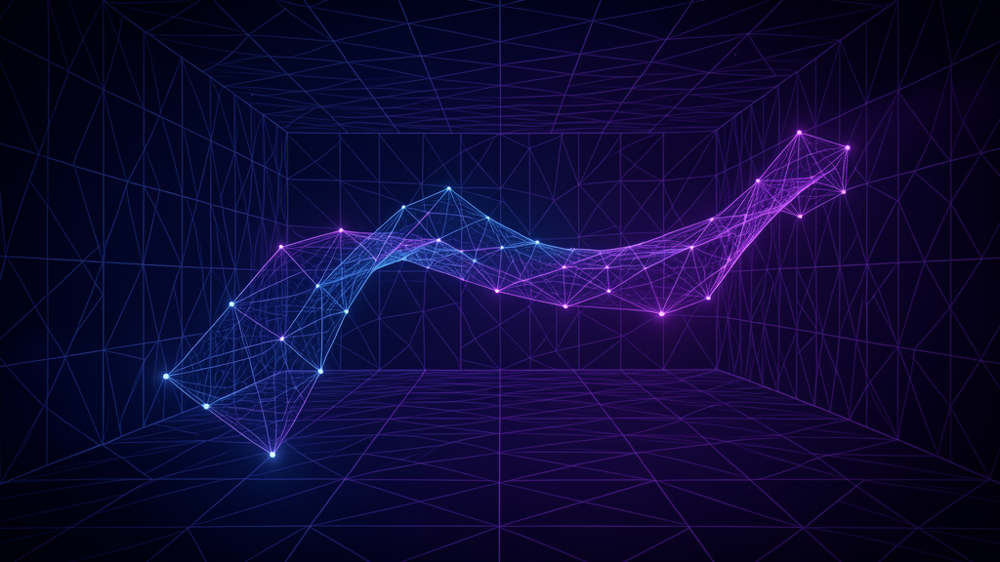

# LingBot Spatial



**Streaming 3D reconstruction for Apple Vision Pro** — a spatial computing demo that brings [LingBot-Map](https://github.com/Robbyant/lingbot-map) (Robbyant) concepts into mixed reality.

LingBot-Map is a feed-forward **Geometric Context Transformer** for reconstructing scenes from streaming video. This app is the visionOS client experience: glass controls, a table-scale volumetric preview, and a mixed immersive walkthrough where poses, keyframe frustums, and dense colored geometry stream into the room around you.

| | |
|---|---|
| **App** | LingBot Spatial |
| **Repo** | [Sdefendre/lingbot-vision-pro](https://github.com/Sdefendre/lingbot-vision-pro) |
| **Platform** | visionOS 2.0+ (Apple Vision Pro + Simulator) |
| **Stack** | SwiftUI · RealityKit · Observation · simd |
| **Bundle ID** | `com.defendresolutions.LingBotSpatial` |
| **Upstream** | [Robbyant/lingbot-map](https://github.com/Robbyant/lingbot-map) (Apache-2.0) |
| **Author** | [Steve Defendre](https://github.com/Sdefendre) · [Defendre Solutions](https://www.defendresolutions.com) |

[](https://developer.apple.com/visionos/)
[](https://www.swift.org)
[](LICENSE)
[](https://www.defendresolutions.com/projects/lingbot-vision-pro)

---

## Why this exists

Spatial reconstruction research usually lives on a CUDA workstation and a desktop visualizer. LingBot Spatial answers a product question:

> What does feed-forward streaming reconstruction *feel like* when you can walk around it on Vision Pro?

The headset runs a high-quality **on-device demo stream** shaped like LingBot-Map outputs (poses, keyframes, confidence-weighted colored points). A Python export bridge and `PLYLoader` support bringing **real** GPU pipeline geometry into the same RealityKit views.

---

## Features

### Three coordinated experiences

1. **Glass control window** — scene gallery, stream transport (play / pause / step / seek / reset), confidence · point size · stream rate, color modes, trajectory & frustum toggles  
2. **Volumetric window** — table-scale reconstruction you can walk around while the stream runs  
3. **Mixed immersive space** — full spatial walkthrough with an in-space HUD; drag to reposition, pinch-magnify to scale  

### Visualization controls

| Control | Behavior |
|---|---|
| Confidence | Hide low-confidence points |
| Point size | RealityKit batch marker scale |
| Stream rate | ~4–30 FPS playback of precomputed frames |
| Color mode | RGB · Confidence · Height · Stream age |
| Trajectory | Camera path line through accumulated poses |
| Frustums | Keyframe camera pyramids |
| Keyframes only | Accumulate points mainly on keyframe steps |

### Demo scenes (no GPU server required)

| Scene | Feel |
|---|---|
| Courthouse | Outdoor landmark, sky-masked facade |
| University | Campus-scale path |
| Loop Closure | Closed trajectory + drift-correction vibe |
| Oxford Spires | Large outdoor terrain + structures |
| Indoor Walkthrough | Long corridor / room sequence |
| Aerial Survey | Bird’s-eye city-block map |

Each scene streams **poses**, **keyframes**, and **dense colored points** with confidence — the same *shape* of data LingBot-Map emits from its demo / batch pipelines.

---

## Quick start (Vision Pro or Simulator)

### Requirements

- Mac with **Xcode 16+** and the **visionOS 2** SDK  
- Apple Vision Pro **or** visionOS Simulator  
- Apple Developer account (free for Simulator; paid team for device install)  
- Same Apple ID on Mac and Vision Pro for wireless / developer strap deploy  

### Build & run

```bash
git clone https://github.com/Sdefendre/lingbot-vision-pro.git
cd lingbot-vision-pro
open LingBotSpatial.xcodeproj
```

1. Select the **LingBotSpatial** target → **Signing & Capabilities**  
2. Enable **Automatically manage signing** and choose your **Team**  
3. Run destination: **Apple Vision Pro** or **Apple Vision Pro (Simulator)**  
4. Press **⌘R**  

### In-headset flow

1. Allow world sensing if prompted  
2. Pick a scene (start with **Courthouse** or **Loop Closure**)  
3. **Play Stream**  
4. **Open Volume** and/or **Enter Immersive Space**  
5. Immersive: drag to reposition the map; pinch-magnify to scale  
6. Use the floating HUD to pause / reset / exit  

### First-run tips

- Raise **Confidence** if the cloud feels noisy; lower **Point size** for denser looks  
- Open **Volume** while streaming for a desk-scale second view  
- **Keyframes only** sparsifies the cloud on long indoor sequences  

---

## Production path (real LingBot-Map geometry)

Run LingBot-Map on a CUDA machine, convert predictions to ASCII PLY, then load with the app’s `PLYLoader` (developer path — see notes below).

```bash
# On your GPU machine (see upstream README)
python demo.py --model_path lingbot-map-long.pt \
  --image_folder example/courthouse --mask_sky

# Convert predictions → ASCII PLY for the headset
python scripts/export_ply_for_vision.py \
  --predictions_dir /path/to/predictions \
  --output scene.ply \
  --stride 4 \
  --conf_threshold 1.5
```

The exporter accepts channel-last RGB/RGBA prediction arrays and normalized or
byte-range RGB in `--xyzrgb` arrays. Unreadable prediction files are reported and
skipped; if none can be read, the command exits without writing an output.

Supported PLY layout (ASCII):

```text
x y z [red green blue] [confidence]
```

The PLY reader uses named vertex properties in any order, preserves dark byte
colors, and rejects incomplete headers, rows, or non-finite coordinates. Vertex
data must precede other nonempty elements. Binary PLY and vertex list properties
are not supported.

Also accepts a single `N×3` / `N×6` `.npy` via `--xyzrgb`. Full script docs: [`scripts/export_ply_for_vision.py`](scripts/export_ply_for_vision.py).

---

## Architecture

Deeper technical notes for portfolio reviewers: [`docs/OVERVIEW.md`](docs/OVERVIEW.md).  
Contributing guide: [`CONTRIBUTING.md`](CONTRIBUTING.md).

```text
LingBotSpatial/
  App/                      # @main — WindowGroup + volumetric + ImmersiveSpace
  Models/                   # Points, poses, demo scenes, settings
  Engine/
    DemoSceneGenerator      # Procedural streaming frames (GCT-shaped)
    ReconstructionSession   # @Observable playback / accumulation / filters
    PLYLoader               # ASCII PLY import / export helpers
  Reality/
    PointCloudEntityBuilder # Batched colored RealityKit meshes
    TrajectoryEntities      # Path + camera frustums
    ImmersiveReconstructionView
    VolumetricPreview
  Views/                    # Gallery, glass controls, settings
scripts/
  export_ply_for_vision.py  # LingBot-Map NPZ/NPY → vision-friendly PLY
```

**Stream model** (mirrors LingBot-Map concepts):

- Per-frame **camera pose** (position + rotation, keyframe flag)  
- **Keyframe interval** (non-keyframes can still contribute points)  
- **Confidence** filtering for visibility  
- Accumulated world point cloud with a memory cap for long runs (~120k points)  
- Render budgets: immersive ~40k filtered points; volume ~25k  

```text
DemoSceneGenerator / PLY
        │
        ▼
ReconstructionSession  ──settings──► filteredPoints / poses
        │
        ├──────────────► VolumetricPreview (table volume)
        └──────────────► ImmersiveReconstructionView (mixed space + HUD)
```

---

## Related work

| Repo | Role |
|---|---|
| [Robbyant/lingbot-map](https://github.com/Robbyant/lingbot-map) | Upstream model, training, viser demo, offline renderer |
| [Sdefendre/lingbot-map](https://github.com/Sdefendre/lingbot-map) | Fork for experiments / collaboration |
| **This repo** | visionOS spatial client + demo UX |

**Paper:** *Geometric Context Transformer for Streaming 3D Reconstruction* — [arXiv:2604.14141](https://arxiv.org/abs/2604.14141)

---

## Author

Built by **Steve Defendre** ([@Sdefendre](https://github.com/Sdefendre)), founder of [Defendre Solutions](https://www.defendresolutions.com) — veteran-owned software, AI, and spatial computing work.

Collaboration welcome via GitHub issues and PRs on this repository.

---

## Featured on

Case study: [defendresolutions.com/projects/lingbot-vision-pro](https://www.defendresolutions.com/projects/lingbot-vision-pro)  
Results index: [defendresolutions.com/results](https://www.defendresolutions.com/results)

---

## Scope & limitations

Documented so the project stays honest for portfolio readers and collaborators:

1. **Xcode on Mac is required** to compile and install to Vision Pro. Command-line tools alone are not enough for a device binary.  
2. **On-device inference** of the full LingBot-Map PyTorch/CUDA stack is **not** included — Vision Pro does not run that pipeline. The demo uses procedural streams that match the data model, plus a PLY bridge for real exports.  
3. **`PLYLoader` is implemented** and covered by the export script; there is **no end-user document picker UI** yet. Real PLY is intended for developers wiring `Resources` or a future import flow.  
4. **Point rendering** uses batched colored meshes for compatibility and clarity. Metal mesh shaders / `LowLevelMesh` could raise point counts further.  
5. Immersive placement supports **drag** and **pinch-to-scale**; immersion style is mixed reality (the immersive space declares mixed / progressive / full capability with mixed as the default selection).

---

## License

App code in this repository is **Apache-2.0** — see [LICENSE](LICENSE).  

LingBot-Map weights, datasets, and third-party assets remain under their original licenses — see the [upstream LICENSE](https://github.com/Robbyant/lingbot-map/blob/main/LICENSE.txt).

---

Built to present well in the headset: glass UI, volumetric + immersive dual views, live trajectory, keyframe frustums, and a stream that feels like watching LingBot-Map think in 3D.
